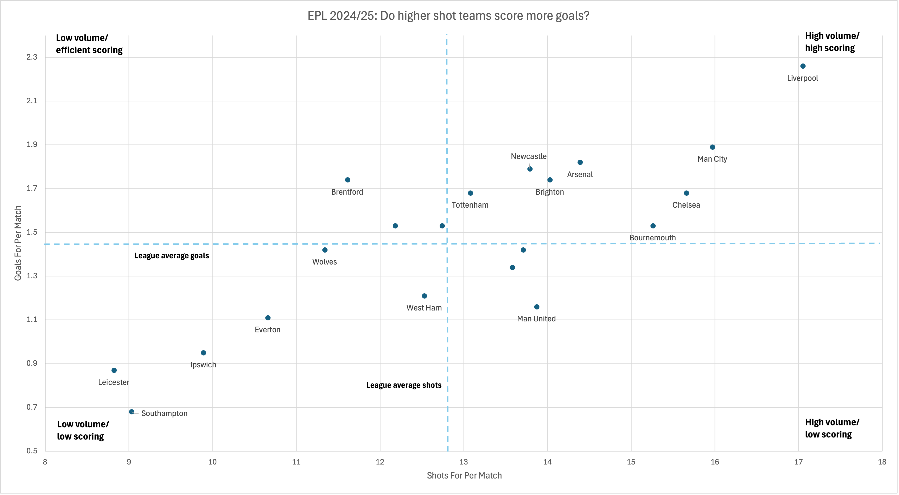

# EPL Shot Quality Analysis

## Project Overview
This project analyses the 2024/25 English Premier League season to understand how teams create attacking value, how efficiently they convert chances, and which teams are most vulnerable defensively.

The project is designed as a portfolio piece to demonstrate data analytics skills using football data, with a focus on SQL, data cleaning, metric design, and analytical interpretation.

## Objectives
- Analyse team attacking output using shot volume, expected goals, and shot quality.
- Compare finishing efficiency using goals versus expected goals.
- Identify teams that concede high-quality chances.
- Build player-level shooting and finishing profiles.
- Communicate findings clearly through summary tables and visual outputs.

## Key Questions
1. Which EPL teams create the highest shot volume?
2. Which teams create the highest-quality chances?
3. Which teams outperform or underperform their expected goals?
4. Which teams are most defensively vulnerable?
5. Which players contribute most to shooting output and finishing efficiency?

## Tools
- SQL
- Excel
- GitHub

## Repository Structure
```text
data/
  raw/        original downloaded datasets
  clean/      cleaned datasets used for analysis

docs/
  project_notes.md
  data_dictionary.md

outputs/
  charts/     visual outputs
  tables/     exported summary tables

sql/
  01_raw_tables.sql
  02_clean_tables.sql
  03_derived_tables.sql
  04_analysis_queries.sql
```

## Initial Visuals

### Attacking Volume vs Scoring Output



This chart compares team shot volume with scoring output across the 2024/25 Premier League season.

Each point represents one team. The dashed reference lines show the league averages for shots per match and goals per match.

The chart provides an early view of which teams generated high attacking volume, which teams converted that volume into goals, and which teams may require deeper expected goals analysis to separate finishing efficiency from chance quality.

## Project Status

Football-Data match data has been imported, cleaned, reshaped, aggregated, exported, and used to create the first exploratory visual.

Current stage:
- raw match data uploaded
- clean selected-column dataset created
- MySQL database created
- `raw_matches` table created
- `clean_matches` table created
- `team_match_stats` table created
- `team_season_summary` table created
- export-ready SQL views created
- first analysis tables exported to `outputs/tables`
- first exploratory chart added to `outputs/charts`
